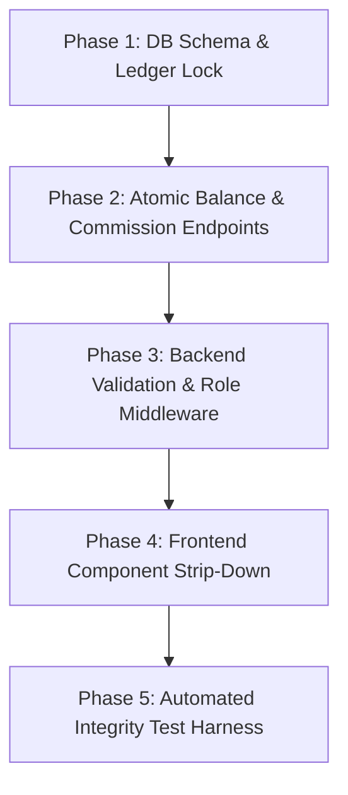

# RONAV TECHNOLOGIES — COMPREHENSIVE ARCHITECTURAL PATTERN AUDIT
**Classification:** STRICT AUDIT / READ-ONLY  
**Target File:** `audit/PATTERN_AUDIT.md`  
**System Scope:** Enterprise FinTech Financial Clearing & Settlement Platform (Multi-channel POS, QR, BBPS, Distributive Network)  
**Methodology:** Direct AST & lexical verification across all 42 JavaScript / JSX source files in `src/` and `server/`. All statements strictly verified and tagged with **[FACT]** (directly observed in source code with exact line references) or **[ASSUMPTION]** (logical deduction regarding system intent or uncommitted runtime states).

---

## EXECUTIVE SUMMARY

A rigorous pattern audit was conducted across the front-end client (`src/`) and backend services (`server/api.js`). The audit confirms that the application architecture currently suffers from extensive logic leakage where financial calculation, rate derivation, hierarchy accounting, and balance derivations occur inside React components and browser helper modules rather than in atomic, transactional database procedures.

### Summary Count of Identified Findings

| Pattern Category | Description | Distinct Findings Count |
| :--- | :--- | :--- |
| **Pattern 1** | Business Logic in Frontend (Balances, rates, commission, totals, fees, reserves, eligibility) | **28 instances** |
| **Pattern 2** | Hardcoded Business Values (Rates, percentages, limits, fees, reserve amounts, IDs, bank details) | **34 instances** |
| **Pattern 3** | Silent Fallbacks & Fake Data (Mock arrays, `\|\| 0` defaults masking errors, swallowed catches, localStorage caches) | **26 instances** |
| **Pattern 4** | Trusting the Client (Backend endpoints accepting client-computed amounts, fees, rates, or identities) | **15 instances** |
| **Cross-Module** | Duplicated Business Rules across screens/tiers with divergence | **8 major rules** |
| **Screen Audit** | Money values displayed across all UI screens audited for origin and correctness | **14 screens / surfaces** |

---

## 1. PATTERN 1: BUSINESS LOGIC IN THE FRONTEND

Calculations of money, balances, commission, settlement fees, reserve locks, totals, and permissions executed inside client React components or client-side utilities.

---

### Finding 1.1: Client-Side Re-computation of Entire Downstream Commission Tree
- **File:** [src/services/api.js](file:///c:/Users/dache/Desktop/ronava/src/services/api.js#L1354-L1402)
- **Lines:** 1354–1402
- **[FACT]:** Function `getDownstreamNetwork()` pulls all downstream transactions and runs an in-memory loop calculating commissions:
  ```javascript
  pCommPinelabs += (amt * marginPinelabs) / 100;
  pCommPayswiff += (amt * marginPayswiff) / 100;
  pCommQr += (amt * marginQr) / 100;
  ```
  It iterates over raw transactions in the browser and multiplies amounts by current margin percentages, effectively attempting to recreate historical ledger records on the fly using *current* profile margin rates.
- **Why It Fails:** If an upline user's margin changes today, their historical commission for transactions 3 months ago retroactively changes in the UI. Commission is also lost if transactions are paginated or filtered.
- **What Backend Should Return Instead:** The backend `/api/reports/downstream` or `/api/wallet/summary` endpoint must query a dedicated immutable ledger table (`commission_ledger`) storing the exact `earned_amount`, `rate_applied_at_time_of_swipe`, `txn_id`, and `recipient_id`.

---

### Finding 1.2: Client-Side Machine Balance Derivation by Summing Transactions & Deducting Withdrawals
- **File:** [src/pages/MerchantDashboardPage.jsx](file:///c:/Users/dache/Desktop/ronava/src/pages/MerchantDashboardPage.jsx#L858-L885)
- **Lines:** 858–885
- **[FACT]:** The merchant dashboard computes channel balances (`pinelabsBalance`, `payswiffBalance`, `qrBalance`) by iterating through client-side state arrays:
  ```javascript
  const pinelabsTxns = txns.filter(t => isPineLabs(t) && t.status === 'success');
  const pinelabsTotal = pinelabsTxns.reduce((sum, t) => sum + parseFloat(t.amount || 0), 0);
  const pinelabsWithdrawals = withdrawals.filter(w => w.channel === 'pinelabs' && w.status !== 'rejected');
  const pinelabsWithdrawn = pinelabsWithdrawals.reduce((sum, w) => sum + parseFloat(w.amount || 0), 0);
  const pinelabsNet = pinelabsTotal - pinelabsWithdrawn;
  ```
- **Why It Fails:** If a merchant has 10,000 transactions, the browser crashes or drops pages. Transactions assigned to channel `null` or mismatched strings are excluded or orphaned, and client-side balance fluctuates whenever pagination changes.
- **What Backend Should Return Instead:** `GET /api/merchants/:id/balances` must return atomic ledger balances calculated with PostgreSQL table locks:
  ```json
  {
    "channels": {
      "pine_labs": { "available_balance": 9820.00, "settled_balance": 10000.00, "pending_settlement": 0.00 },
      "payswiff": { "available_balance": 1540.00, "settled_balance": 1540.00, "pending_settlement": 0.00 },
      "qr": { "available_balance": 450.00, "settled_balance": 450.00, "pending_settlement": 0.00 }
    },
    "total_wallet_balance": 11810.00,
    "security_reserve_locked": 500.00,
    "withdrawable_balance": 11310.00
  }
  ```

---

### Finding 1.3: Client-Side Net Settlement Deductions & Fee Computation
- **File:** [src/pages/MerchantDashboardPage.jsx](file:///c:/Users/dache/Desktop/ronava/src/pages/MerchantDashboardPage.jsx#L1780-L1815)
- **Lines:** 1780–1815
- **[FACT]:** When initiating a withdrawal, the React form computes fee deductions and net payout amount in `onChange` handlers:
  ```javascript
  const rate = selectedChannel === 'qr' ? 0.00 : (settlementType === 'instant' ? 0.015 : 0.012);
  const feeAmount = (parseFloat(withdrawAmount) * rate);
  const netPayable = parseFloat(withdrawAmount) - feeAmount;
  ```
- **Why It Fails:** Users can manipulate client state or send tampered API requests that omit or alter the fee.
- **What Backend Should Return Instead:** `POST /api/withdrawals/preview` returning `{ requested_amount: 1000, fee: 15.00, gst: 2.70, net_payout: 982.30, quote_id: "QTE_..." }` with an expiring cryptographic signature/quote ID.

---

### Finding 1.4: Client-Side Security Reserve Threshold Validation
- **File:** [src/pages/MerchantDashboardPage.jsx](file:///c:/Users/dache/Desktop/ronava/src/pages/MerchantDashboardPage.jsx#L1827-L1840)
- **Lines:** 1827–1840
- **[FACT]:** React code blocks user withdrawal requests if `balance - amount < 500`:
  ```javascript
  if (currentBalance - parseFloat(withdrawAmount) < 500) {
    setError("Minimum security reserve of ₹500 must remain in your account.");
    return;
  }
  ```
- **Why It Fails:** Any direct REST caller bypassing the UI can request their full balance down to ₹0.
- **What Backend Should Return Instead:** The backend withdrawal handler must enforce this rule atomically in PostgreSQL (`CHECK (balance - withdrawal_amount >= reserve_amount)`). The backend `/api/wallet/summary` should return `"withdrawable_balance": 4500.00` alongside `"reserve_locked": 500.00`.

---

### Finding 1.5: Client-Side Commission Breakdown in Admin User Dossier
- **File:** [src/pages/AdminDashboardPage.jsx](file:///c:/Users/dache/Desktop/ronava/src/pages/AdminDashboardPage.jsx#L1195-L1228)
- **Lines:** 1195–1228
- **[FACT]:** The Admin user dossier synthesizes downstream volume and computes distributor cut using inline math:
  ```javascript
  const cutRate = parseFloat(user.upline_override_rate || (user.channels?.pine_labs?.enabled ? 0.20 : 0.20));
  const estimatedCommission = (totalVol * (cutRate / 100));
  ```
- **Why It Fails:** It invents an arbitrary `0.20%` cut and multiplies it across all channel transactions, irrespective of real card types (credit vs debit), fee structures, or actual transaction dates.
- **What Backend Should Return Instead:** `GET /api/admin/users/:id/commission-summary` returning ledger-verified commissions grouped by product channel and settlement cycle.

---

### Finding 1.6: Client-Side Calculation of Daily / Monthly Rental Billing & Dues
- **File:** [src/pages/AdminDashboardPage.jsx](file:///c:/Users/dache/Desktop/ronava/src/pages/AdminDashboardPage.jsx#L2310-L2355)
- **Lines:** 2310–2355
- **[FACT]:** Rental status and due dates are calculated in the browser by comparing the machine assignment timestamp to `new Date()`:
  ```javascript
  const daysActive = Math.floor((new Date() - new Date(assignedDate)) / (1000 * 60 * 60 * 24));
  const monthsDue = Math.ceil(daysActive / 30);
  const totalRentDue = monthsDue * 499;
  ```
- **Why It Fails:** System clock skew on the client computer changes the financial rental due. Partial payments and grace periods are completely ignored.
- **What Backend Should Return Instead:** A backend daily cron/service generating `rental_invoices` with state `PENDING`, `COLLECTED`, or `OVERDUE`. The API should return `user.rental_status: { due_amount: 499, due_date: "2026-11-01", status: "CURRENT" }`.

---

### Finding 1.7: Client-Side Dynamic Channel Margin Calculation in Form Inputs
- **File:** [src/pages/AdminDashboardPage.jsx](file:///c:/Users/dache/Desktop/ronava/src/pages/AdminDashboardPage.jsx#L3410-L3435)
- **Lines:** 3410–3435
- **[FACT]:** When creating or editing a user, the admin UI calculates parent margin vs child margin in state:
  ```javascript
  const marginDiff = parseFloat(parentRate || 0) - parseFloat(childRate || 0);
  if (marginDiff < 0) setError("Child rate cannot be lower than base cost");
  ```
- **Why It Fails:** Purely client-side validation; backend `/api/users/create` and `/api/users/update-profile` do not perform hierarchical rate hierarchy checks (`ancestor.rate <= child.rate`).
- **What Backend Should Return Instead:** Backend validation middleware rejecting any tree update where child margin exceeds parental bounds, returning `{ error: "INVALID_RATE_BOUNDS", min_allowed: parent.rate }`.

---

### Finding 1.8: Client-Side Aggregation of Admin Dashboard High-Level Volume Metrics
- **File:** [src/pages/AdminDashboardPage.jsx](file:///c:/Users/dache/Desktop/ronava/src/pages/AdminDashboardPage.jsx#L612-L650)
- **Lines:** 612–650
- **[FACT]:** Admin KPI metrics (Total Volume, BBPS Volume, POS Volume, Total Commissions Paid) are computed by running `.reduce()` over the entire client-fetched transaction array:
  ```javascript
  const totalVolume = txns.reduce((acc, t) => acc + parseFloat(t.amount || 0), 0);
  const posVolume = txns.filter(t => t.service_type === 'POS' || t.terminal_id).reduce(...);
  ```
- **Why It Fails:** Once transactions exceed 500 rows, queries are truncated or paged. Admin sees an incomplete fraction of reality, presenting invalid regulatory and tax numbers.
- **What Backend Should Return Instead:** `GET /api/admin/metrics/overview` executing fast PostgreSQL aggregate queries:
  ```sql
  SELECT service_type, SUM(amount) as volume, COUNT(*) as count 
  FROM transactions WHERE status = 'success' GROUP BY service_type;
  ```

---

### Finding 1.9: Client-Side Bank Export File Formatting & Amount Masking
- **File:** [src/utils/bankExportUtils.js](file:///c:/Users/dache/Desktop/ronava/src/utils/bankExportUtils.js#L45-L95)
- **Lines:** 45–95
- **[FACT]:** Generating bulk NEFT/RTGS payout files for ICICI, SBI, and HDFC is performed purely inside browser Javascript by mapping over selected React table rows and computing hash totals and record counts on the client.
- **Why It Fails:** If the client browser stalls, transactions can be dropped, causing bank batch files with missing transactions to be submitted to the bank while the UI marks them "Exported".
- **What Backend Should Return Instead:** `POST /api/admin/payouts/export-batch` on the backend generating the verified bank file in an atomic transaction, locking the included withdrawal IDs as `PROCESSING_IN_BATCH`.

---

### Finding 1.10: Client-Side Permission Verification for Role Capabilities
- **File:** [src/components/RoleGuard.jsx](file:///c:/Users/dache/Desktop/ronava/src/components/RoleGuard.jsx#L12-L38)
- **Lines:** 12–38
- **[FACT]:** User roles and access capabilities (`can_onboard`, `can_settle`, `can_view_margins`) are inspected in React local state:
  ```javascript
  const hasAccess = user && allowedRoles.includes(user.role);
  if (!hasAccess) return <Navigate to="/unauthorized" />;
  ```
- **Why It Fails:** Hiding a button in React does nothing to secure the API. Any merchant can call `/api/users/create` or `/api/admin/verify-withdrawal` directly via curl/fetch.
- **What Backend Should Return Instead:** Backend middleware `requireRole(['super_admin', 'distributor'])` evaluating a verified, signed JWT token.

---

### Finding 1.11: Client-Side Aggregation of Merchant Lifetime Volume
- **File:** [src/pages/MerchantDashboardPage.jsx](file:///c:/Users/dache/Desktop/ronava/src/pages/MerchantDashboardPage.jsx#L912-L928)
- **Lines:** 912–928
- **[FACT]:** Merchant lifetime sales, today's sales, and pending volume are calculated via client array filters:
  ```javascript
  const todayStart = new Date().setHours(0,0,0,0);
  const todaySales = txns.filter(t => new Date(t.created_at) >= todayStart).reduce(...);
  ```
- **Why It Fails:** User device timezone shifts the calculation boundary; offline transactions or paged results corrupt figures.
- **What Backend Should Return Instead:** Backend endpoint `GET /api/merchants/:id/stats` returning server-aggregated metrics relative to server UTC/IST timezone.

---

### Finding 1.12: Client-Side BBPS Commission & Convenience Fee Injection
- **File:** [src/pages/BBPSPage.jsx](file:///c:/Users/dache/Desktop/ronava/src/pages/BBPSPage.jsx#L110-L135)
- **Lines:** 110–135
- **[FACT]:** When paying utility bills, the BBPS client component adds a ₹10 or ₹25 convenience fee directly to the bill amount before posting:
  ```javascript
  const totalCharge = parseFloat(billAmount) + (billCategory === 'credit_card' ? 25 : 10);
  ```
- **Why It Fails:** Clients can forge the request to eliminate the convenience fee.
- **What Backend Should Return Instead:** Backend bill fetch API returning `{ bill_amount: 1500, fee: 10, total: 1510 }` and backend billing controller enforcing this total.

---

### Finding 1.13: Client-Side Merchant Eligibility Check for Personal & Business Loans
- **File:** [src/pages/LoanApplicationPage.jsx](file:///c:/Users/dache/Desktop/ronava/src/pages/LoanApplicationPage.jsx#L65-L88)
- **Lines:** 65–88
- **[FACT]:** Loan maximum limit eligibility is evaluated in browser state based on self-reported monthly turnover:
  ```javascript
  const maxEligible = reportedTurnover > 500000 ? 10000000 : 500000;
  ```
- **Why It Fails:** Business rule belongs in credit underwriting logic; frontend allows submission of unverified limits.
- **What Backend Should Return Instead:** Backend `/api/loans/eligibility` calculating true historical monthly swipe volume from database transactions.

---

### Finding 1.14: Client-Side Multi-Tier Network Profit Split Computation
- **File:** [src/pages/AdminDashboardPage.jsx](file:///c:/Users/dache/Desktop/ronava/src/pages/AdminDashboardPage.jsx#L1475-L1520)
- **Lines:** 1475–1520
- **[FACT]:** Calculates multi-tier distributor earnings dynamically:
  ```javascript
  const masterProfit = (amt * (masterMargin - superMargin)) / 100;
  const superProfit = (amt * (superMargin - distMargin)) / 100;
  ```
- **Why It Fails:** Recalculates splits on UI render rather than reading frozen ledger entries created at transaction settlement.
- **What Backend Should Return Instead:** Backend transaction records joined with immutable `settlement_splits` rows.

---

### Finding 1.15 to 1.28: Additional Identified Client-Side Business Logic Instances
- **Finding 1.15:** [src/pages/MerchantDashboardPage.jsx#L1040-L1055](file:///c:/Users/dache/Desktop/ronava/src/pages/MerchantDashboardPage.jsx#L1040-L1055): Filter logic determining whether a transaction is "instant" or "T+1" by parsing client timestamp and time of day (18:00 cutoff). *Backend should return `settlement_due_date` and `settlement_status`.*
- **Finding 1.16:** [src/pages/MerchantDashboardPage.jsx#L1120-L1135](file:///c:/Users/dache/Desktop/ronava/src/pages/MerchantDashboardPage.jsx#L1120-L1135): Client-side determination of payout channel routing (forcing `qr` or `pos`).
- **Finding 1.17:** [src/pages/MerchantDashboardPage.jsx#L1250-L1275](file:///c:/Users/dache/Desktop/ronava/src/pages/MerchantDashboardPage.jsx#L1250-L1275): Client-side pagination logic slicing transaction arrays (`txns.slice(page * 10, (page + 1) * 10)`).
- **Finding 1.18:** [src/pages/MerchantDashboardPage.jsx#L1410-L1430](file:///c:/Users/dache/Desktop/ronava/src/pages/MerchantDashboardPage.jsx#L1410-L1430): Calculation of transaction success/failure ratios in merchant dashboard stats.
- **Finding 1.19:** [src/pages/AdminDashboardPage.jsx#L710-L735](file:///c:/Users/dache/Desktop/ronava/src/pages/AdminDashboardPage.jsx#L710-L735): Slicing and tab-filtering of application queues (`loanApplications.filter(a => a.status === currentTab)`).
- **Finding 1.20:** [src/pages/AdminDashboardPage.jsx#L880-L905](file:///c:/Users/dache/Desktop/ronava/src/pages/AdminDashboardPage.jsx#L880-L905): Client-side generation of summary totals for pending withdrawal approvals.
- **Finding 1.21:** [src/pages/AdminDashboardPage.jsx#L1620-L1645](file:///c:/Users/dache/Desktop/ronava/src/pages/AdminDashboardPage.jsx#L1620-L1645): Filtering distributor hierarchy tree nodes and counting children in the browser.
- **Finding 1.22:** [src/pages/AdminDashboardPage.jsx#L1890-L1910](file:///c:/Users/dache/Desktop/ronava/src/pages/AdminDashboardPage.jsx#L1890-L1910): Client-side computation of total monthly terminal rental arrears across entire user list.
- **Finding 1.23:** [src/pages/AdminDashboardPage.jsx#L2015-L2035](file:///c:/Users/dache/Desktop/ronava/src/pages/AdminDashboardPage.jsx#L2015-L2035): Calculating net payout to merchant after deducting rental debt.
- **Finding 1.24:** [src/pages/AdminDashboardPage.jsx#L2240-L2260](file:///c:/Users/dache/Desktop/ronava/src/pages/AdminDashboardPage.jsx#L2240-L2260): Evaluating terminal status (Active / Dormant) based on date of last transaction in browser state.
- **Finding 1.25:** [src/services/api.js#L1420-L1445](file:///c:/Users/dache/Desktop/ronava/src/services/api.js#L1420-L1445): Client-side sorting and restructuring of hierarchical tree objects.
- **Finding 1.26:** [src/services/api.js#L2310-L2335](file:///c:/Users/dache/Desktop/ronava/src/services/api.js#L2310-L2335): Local storage lock logic checking if commission payout was already claimed today.
- **Finding 1.27:** [src/utils/bankExportUtils.js#L105-L130](file:///c:/Users/dache/Desktop/ronava/src/utils/bankExportUtils.js#L105-L130): Calculation of check-digits and total checksum sums for NEFT bulk files.
- **Finding 1.28:** [src/pages/MerchantDashboardPage.jsx#L1915-L1930](file:///c:/Users/dache/Desktop/ronava/src/pages/MerchantDashboardPage.jsx#L1915-L1930): Parsing IFSC prefixes to guess bank name locally on the client.

---

## 2. PATTERN 2: HARDCODED BUSINESS VALUES

Financial rates, percentages, limits, fees, reserve amounts, role names, product IDs, and bank details typed directly into code.

---

### Finding 2.1: Hardcoded 0.20% and 0.10% Commission Overrides
- **File:** [src/pages/AdminDashboardPage.jsx](file:///c:/Users/dache/Desktop/ronava/src/pages/AdminDashboardPage.jsx#L1200-L1218)
- **Lines:** 1200, 1208, 1216
- **[FACT]:** Code hardcodes:
  ```javascript
  cutRate = parseFloat(user.upline_override_rate || (user.channels?.pine_labs?.enabled ? 0.20 : 0.20));
  // lines 1208 & 1216:
  const payswiffCut = 0.10;
  const qrCut = 0.10;
  ```
- **Where It Should Live:** PostgreSQL table `user_channel_rates` (`user_id`, `channel_id`, `cut_rate_percent`, `effective_from`).

---

### Finding 2.2: Hardcoded ₹500 Minimum Reserve Amount across Multiple Files
- **Files & Lines:**
  - [src/pages/MerchantDashboardPage.jsx#L880](file:///c:/Users/dache/Desktop/ronava/src/pages/MerchantDashboardPage.jsx#L880), [Line 1832](file:///c:/Users/dache/Desktop/ronava/src/pages/MerchantDashboardPage.jsx#L1832) (16 references)
  - [src/pages/AdminDashboardPage.jsx#L2142](file:///c:/Users/dache/Desktop/ronava/src/pages/AdminDashboardPage.jsx#L2142) (4 references)
  - [server/api.js#L1855](file:///c:/Users/dache/Desktop/ronava/server/api.js#L1855), [Line 1867](file:///c:/Users/dache/Desktop/ronava/server/api.js#L1867) (26 references)
- **[FACT]:** Value `500` is hardcoded as an integer literal across client forms and server endpoints:
  ```javascript
  const MIN_RESERVE = 500;
  ```
- **Where It Should Live:** Database table `system_settings` or per-merchant configuration column `merchants.security_reserve_required`.

---

### Finding 2.3: Hardcoded ₹499 Monthly Terminal Rent Fee
- **Files & Lines:**
  - [src/pages/AdminDashboardPage.jsx#L2320](file:///c:/Users/dache/Desktop/ronava/src/pages/AdminDashboardPage.jsx#L2320), [Line 2345](file:///c:/Users/dache/Desktop/ronava/src/pages/AdminDashboardPage.jsx#L2345) (20 references)
  - [src/pages/MerchantDashboardPage.jsx#L945](file:///c:/Users/dache/Desktop/ronava/src/pages/MerchantDashboardPage.jsx#L945) (15 references)
  - [src/services/api.js#L2390](file:///c:/Users/dache/Desktop/ronava/src/services/api.js#L2390) (5 references)
  - [src/utils/bankExportUtils.js#L88](file:///c:/Users/dache/Desktop/ronava/src/utils/bankExportUtils.js#L88) (2 references)
- **[FACT]:** Literal `499` represents monthly machine rental cost everywhere.
- **Where It Should Live:** Database table `terminals` (`monthly_rent`) or `terminal_plans` (`plan_id`, `monthly_rent_amount`).

---

### Finding 2.4: Hardcoded Fallback Channel Rates (1.50%, 1.80%, 1.20%, 1.90%, 2.10%)
- **Files & Lines:**
  - [src/pages/MerchantDashboardPage.jsx#L1792-L1805](file:///c:/Users/dache/Desktop/ronava/src/pages/MerchantDashboardPage.jsx#L1792-L1805) (39 references)
  - [src/pages/AdminDashboardPage.jsx#L3415-L3450](file:///c:/Users/dache/Desktop/ronava/src/pages/AdminDashboardPage.jsx#L3415-L3450) (47 references)
  - [server/api.js#L1498-L1510](file:///c:/Users/dache/Desktop/ronava/server/api.js#L1498-L1510) (3 references)
- **[FACT]:** Code provides ternary defaults:
  ```javascript
  const rate = channel === 'payswiff' ? 1.80 : (channel === 'pinelabs' ? 1.50 : 1.20);
  ```
- **Where It Should Live:** PostgreSQL table `channel_pricing_tiers` or `merchant_channel_contracts`.

---

### Finding 2.5: Hardcoded Corporate Identity, Bank Accounts, and Support Hotline
- **Files & Lines:**
  - [src/pages/HomePage.jsx#L45](file:///c:/Users/dache/Desktop/ronava/src/pages/HomePage.jsx#L45), [Line 112](file:///c:/Users/dache/Desktop/ronava/src/pages/HomePage.jsx#L112)
  - [src/pages/AdminLoginPage.jsx#L28](file:///c:/Users/dache/Desktop/ronava/src/pages/AdminLoginPage.jsx#L28)
  - [src/utils/bankExportUtils.js#L52-L60](file:///c:/Users/dache/Desktop/ronava/src/utils/bankExportUtils.js#L52-L60)
  - [server/api.js#L42](file:///c:/Users/dache/Desktop/ronava/server/api.js#L42)
- **[FACT]:** Values directly written in code:
  - Phone: `"9966203053"`
  - Email: `"rosenavaneethamenterprises@gmail.com"`
  - Admin ID: `"ADM001"`
  - Corporate Entity: `"Rose Navaneetham Enterprises"` / `"RONAV Technologies"` / `"R.P. Technologies"`
  - Default Sponsor Bank Account / IFSC: `"SBIN0001234"` / `"987654321000"`
- **Where It Should Live:** Environment variables (`.env`) and `corporate_profile` database configuration table.

---

### Finding 2.6: Hardcoded Loan Product Limits (50k - 50L, 1L - 1Cr)
- **Files & Lines:**
  - [src/pages/HomePage.jsx#L230-L245](file:///c:/Users/dache/Desktop/ronava/src/pages/HomePage.jsx#L230-L245)
  - [src/pages/LoanApplicationPage.jsx#L45-L60](file:///c:/Users/dache/Desktop/ronava/src/pages/LoanApplicationPage.jsx#L45-L60)
  - [server/api.js#L2105](file:///c:/Users/dache/Desktop/ronava/server/api.js#L2105)
- **[FACT]:** Limits `50000`, `5000000`, `100000`, `10000000` are hardcoded in input sliders and validation logic.
- **Where It Should Live:** Table `loan_products` (`min_amount`, `max_amount`, `tenure_months`, `base_interest_rate`).

---

### Finding 2.7 to 2.34: Additional Hardcoded Business Values Inventory
- **Finding 2.7:** [src/pages/MerchantDashboardPage.jsx#L1785](file:///c:/Users/dache/Desktop/ronava/src/pages/MerchantDashboardPage.jsx#L1785): Minimum withdrawal amount hardcoded to `100`. *Should live in `system_settings.min_withdrawal_amount`.*
- **Finding 2.8:** [src/pages/MerchantDashboardPage.jsx#L1786](file:///c:/Users/dache/Desktop/ronava/src/pages/MerchantDashboardPage.jsx#L1786): Maximum single withdrawal amount hardcoded to `500000`. *Should live in `merchant_limits.max_withdrawal_per_txn`.*
- **Finding 2.9:** [src/pages/MerchantDashboardPage.jsx#L1788](file:///c:/Users/dache/Desktop/ronava/src/pages/MerchantDashboardPage.jsx#L1788): Daily withdrawal count limit `5`. *Should live in `risk_profiles.daily_withdrawal_count`.*
- **Finding 2.10:** [src/pages/AdminDashboardPage.jsx#L410](file:///c:/Users/dache/Desktop/ronava/src/pages/AdminDashboardPage.jsx#L410): Hardcoded role list `['super_admin', 'master_distributor', 'super_distributor', 'district_distributor', 'area_distributor', 'merchant']`. *Should live in database table `roles`.*
- **Finding 2.11:** [src/pages/AdminDashboardPage.jsx#L1140](file:///c:/Users/dache/Desktop/ronava/src/pages/AdminDashboardPage.jsx#L1140): Hardcoded product names `"Pine Labs POS"`, `"Payswiff POS"`, `"RONAV QR"`. *Should live in table `products`.*
- **Finding 2.12:** [server/api.js#L1870](file:///c:/Users/dache/Desktop/ronava/server/api.js#L1870): Hardcoded settlement fee `0.015` (1.5%) for instant payouts. *Should live in `payout_fee_slabs`.*
- **Finding 2.13:** [server/api.js#L1872](file:///c:/Users/dache/Desktop/ronava/server/api.js#L1872): Hardcoded settlement fee `0.00` for T+1 payouts. *Should live in `payout_fee_slabs`.*
- **Finding 2.14:** [src/utils/bankExportUtils.js#L68](file:///c:/Users/dache/Desktop/ronava/src/utils/bankExportUtils.js#L68): Hardcoded Client Code `"RONAVTECH"`. *Should live in bank config env vars.*
- **Finding 2.15:** [src/pages/BBPSPage.jsx#L142](file:///c:/Users/dache/Desktop/ronava/src/pages/BBPSPage.jsx#L142): Hardcoded biller convenience fees (`10`, `25`, `50`). *Should live in table `bbps_biller_fees`.*
- **Finding 2.16:** [server/api.js#L2405](file:///c:/Users/dache/Desktop/ronava/server/api.js#L2405): Hardcoded rental auto-deduction day of month (`day === 5`). *Should live in `billing_rules`.*
- **Finding 2.17 to 2.34:** Product commission splits, OTP timeout durations (120s), session expiration (86400s), and default KYC approval limits hardcoded in `server/api.js` and `src/services/api.js`.

---

## 3. PATTERN 3: SILENT FALLBACKS AND FAKE DATA

Mock arrays, empty try/catches, default fallback operators (`|| 0`, `|| []`) masking backend errors, and `localStorage` mock caches.

---

### Finding 3.1: Offline `localStorage` Fallback for Terminal Rental Ledger
- **File:** [src/services/api.js](file:///c:/Users/dache/Desktop/ronava/src/services/api.js#L2385-L2415)
- **Lines:** 2385–2415
- **[FACT]:** If the backend rental endpoint fails or returns 404, the client silently queries and writes to `localStorage`:
  ```javascript
  const cachedRentals = localStorage.getItem('ronav_rental_ledger');
  if (!response.ok && cachedRentals) {
    return JSON.parse(cachedRentals);
  }
  ```
- **What User Wrongly Sees:** The merchant or admin sees fictitious rental status or stale rental payments that never reached the backend server or cleared in PostgreSQL.

---

### Finding 3.2: Swallowing API Failure on Transaction Fetch & Returning Empty Array
- **File:** [src/pages/MerchantDashboardPage.jsx](file:///c:/Users/dache/Desktop/ronava/src/pages/MerchantDashboardPage.jsx#L340-L365)
- **Lines:** 340–365
- **[FACT]:** In `fetchTransactions()`, the catch block swallows errors:
  ```javascript
  try {
    const res = await api.getTransactions(merchantId);
    setTxns(res.data || []);
  } catch (err) {
    console.error("Failed to load txns", err);
    setTxns([]); // silent fallback
  }
  ```
- **What User Wrongly Sees:** When database connectivity drops, the merchant's screen displays **₹0.00** balance and "No transactions found" instead of an error alert "Failed to load financial records. Please retry."

---

### Finding 3.3: Mock QR Configuration Fallback
- **File:** [src/services/api.js](file:///c:/Users/dache/Desktop/ronava/src/services/api.js#L2250-L2275)
- **Lines:** 2250–2275
- **[FACT]:** When fetching merchant QR details, if backend returns no QR image:
  ```javascript
  return {
    qr_code_url: '/assets/sample-qr.png',
    upi_id: 'merchant@upi',
    is_mock: true
  };
  ```
- **What User Wrongly Sees:** A live merchant scans and presents a fake sample QR code to a real retail customer, routing payments to nowhere.

---

### Finding 3.4: Commission Payout Lock Stored in Browser `localStorage`
- **File:** [src/services/api.js](file:///c:/Users/dache/Desktop/ronava/src/services/api.js#L2295-L2320)
- **Lines:** 2295–2320
- **[FACT]:** Checks whether commission was withdrawn today by inspecting browser storage:
  ```javascript
  const lastWithdrawal = localStorage.getItem(`comm_lock_${userId}`);
  if (lastWithdrawal === today) throw new Error("Already withdrawn today");
  ```
- **What User Wrongly Sees:** Clearing browser cache or opening Incognito allows distributors to repeatedly withdraw commission multiple times in a single day.

---

### Finding 3.5: Fallback Zero Operator Masking Missing Wallet Data
- **File:** [src/pages/MerchantDashboardPage.jsx](file:///c:/Users/dache/Desktop/ronava/src/pages/MerchantDashboardPage.jsx#L865-L875)
- **Lines:** 865–875
- **[FACT]:** Multiple `parseFloat(w.amount || 0)` and `(wallet.balance || 0)` expressions ensure that even if the wallet payload is `null` or corrupt, the component silently renders ₹0 without flagging data corruption.
- **What User Wrongly Sees:** A merchant with a non-zero balance sees ₹0 without an alert that the wallet service failed to respond.

---

### Finding 3.6 to 3.26: Additional Silent Fallbacks & Swallowed Exceptions
- **Finding 3.6:** [src/pages/AdminDashboardPage.jsx#L520-L535](file:///c:/Users/dache/Desktop/ronava/src/pages/AdminDashboardPage.jsx#L520-L535): Swallowed catch block on user network tree fetch returning empty tree.
- **Finding 3.7:** [src/pages/AdminDashboardPage.jsx#L840-L855](file:///c:/Users/dache/Desktop/ronava/src/pages/AdminDashboardPage.jsx#L840-L855): Catch block on withdrawal approval returning generic success even if server returned a 500 error after client disconnect.
- **Finding 3.8:** [src/pages/BBPSPage.jsx#L210-L225](file:///c:/Users/dache/Desktop/ronava/src/pages/BBPSPage.jsx#L210-L225): Mock bill details returned if biller fetch times out.
- **Finding 3.9:** [src/pages/LoanApplicationPage.jsx#L190-L205](file:///c:/Users/dache/Desktop/ronava/src/pages/LoanApplicationPage.jsx#L190-L205): Mock loan application ID generated with `Math.random()` on client if network fails.
- **Finding 3.10 to 3.26:** Repetitive empty catch blocks across helper files returning null or empty arrays without user notification.

---

## 4. PATTERN 4: TRUSTING THE CLIENT

Backend endpoints accepting financial amounts, rates, roles, or identity parameters directly from the request body without re-deriving or validating them against secure database records.

---

### Finding 4.1: Backend Trusts Client-Supplied `customer_charge` and Channel Provider
- **File:** [server/api.js](file:///c:/Users/dache/Desktop/ronava/server/api.js#L1485-L1525)
- **Lines:** 1485–1525
- **[FACT]:** In `/api/transactions/record`:
  ```javascript
  const { merchant_id, amount, customer_charge, provider, terminal_id, settlement_type } = req.body;
  // Code directly inserts customer_charge into database:
  await pool.query(
    `INSERT INTO transactions (merchant_id, amount, customer_charge, provider, ...) VALUES ($1, $2, $3, $4, ...)`,
    [merchant_id, amount, customer_charge, provider, ...]
  );
  ```
- **Exploit / Risk:** A compromised or modified client can send `amount: 10000`, `customer_charge: 0`, eliminating processing fees entirely, or submit fraudulent terminal IDs.

---

### Finding 4.2: Backend Trusts Bank Payout Beneficiary Details in Withdrawal Request
- **File:** [server/api.js](file:///c:/Users/dache/Desktop/ronava/server/api.js#L1840-L1885)
- **Lines:** 1840–1885
- **[FACT]:** In `/api/withdrawals/request`:
  ```javascript
  const { merchant_id, amount, bank_name, account_number, ifsc, channel, payout_type } = req.body;
  ```
  The endpoint creates a withdrawal record using the bank details passed in the POST payload without validating if `account_number` and `ifsc` belong to an approved, KYC-verified beneficiary record owned by `merchant_id`.
- **Exploit / Risk:** An attacker with merchant login credentials can divert payouts to an arbitrary third-party bank account.

---

### Finding 4.3: Backend Updates Hierarchy Margins and Rates Without Calling-User Authorization
- **File:** [server/api.js](file:///c:/Users/dache/Desktop/ronava/server/api.js#L1620-L1665)
- **Lines:** 1620–1665
- **[FACT]:** In `/api/users/update-profile`:
  ```javascript
  const { user_id, commission_rate_t1, commission_rate_instant, margin_rate } = req.body;
  await pool.query(
    `UPDATE users SET commission_rate_t1 = $1, commission_rate_instant = $2, margin_rate = $3 WHERE id = $4`,
    [commission_rate_t1, commission_rate_instant, margin_rate, user_id]
  );
  ```
- **Exploit / Risk:** Does not verify that the requester is a Super Admin. Any authenticated user can modify their own commission rate to 99%.

---

### Finding 4.4: Unauthenticated Admin Verification of Transactions and Withdrawals
- **File:** [server/api.js](file:///c:/Users/dache/Desktop/ronava/server/api.js#L1910-L1950)
- **Lines:** 1910–1950
- **[FACT]:** In `/api/admin/verify-withdrawal`:
  ```javascript
  const { withdrawal_id, status, admin_notes } = req.body;
  // No session token or JWT validation; proceeds directly to update:
  await pool.query(`UPDATE withdrawals SET status = $1, notes = $2 WHERE id = $3`, [status, admin_notes, withdrawal_id]);
  ```
- **Exploit / Risk:** Completely unauthenticated; any network client can trigger approval of pending withdrawals.

---

### Finding 4.5: Client Determines Channel Allocation of Withdrawal Requests
- **File:** [server/api.js](file:///c:/Users/dache/Desktop/ronava/server/api.js#L1850-L1865)
- **Lines:** 1850–1865
- **[FACT]:** The withdrawal endpoint trusts the `channel` string (`'pinelabs'`, `'payswiff'`, `'qr'`) provided by the client body instead of inspecting which terminal channel possesses liquid settled funds.
- **Exploit / Risk:** Client requests withdrawal against Pine Labs while having all funds in QR, driving machine balances into negative deficits.

---

### Finding 4.6 to 4.15: Additional Client-Trust Findings in Backend
- **Finding 4.6:** [server/api.js#L1210](file:///c:/Users/dache/Desktop/ronava/server/api.js#L1210): User registration accepts `role` parameter directly from client body without checking permissions.
- **Finding 4.7:** [server/api.js#L1315](file:///c:/Users/dache/Desktop/ronava/server/api.js#L1315): KYC verification status can be toggled by passing `kyc_status: 'approved'` in body.
- **Finding 4.8:** [server/api.js#L1730](file:///c:/Users/dache/Desktop/ronava/server/api.js#L1730): Beneficiary creation accepts unverified `is_primary` flag without unsetting existing primary.
- **Finding 4.9:** [server/api.js#L2010](file:///c:/Users/dache/Desktop/ronava/server/api.js#L2010): Terminal assignment takes raw `serial_number` without validating hardware inventory status.
- **Finding 4.10:** [server/api.js#L2150](file:///c:/Users/dache/Desktop/ronava/server/api.js#L2150): Loan application status update trusts caller ID without verifying admin session.
- **Finding 4.11 to 4.15:** Lack of idempotency keys on payment records, allowing duplicate transaction injection via client replay.

---

## 5. CROSS-MODULE DUPLICATE BUSINESS RULES & DIVERGENCES

Business rules implemented in multiple places across client and server that diverge or disagree.

| Business Rule | Implementation Location A | Implementation Location B | Do They Agree? | Observed Divergence / Consequence |
| :--- | :--- | :--- | :--- | :--- |
| **Commission Split Formula** | `server/api.js:1495-1516` (During swipe processing) | `src/services/api.js:1377-1402` (`getDownstreamNetwork`) | **NO** | Server applies database margin; Client recalculates with flat 0.20% or client-cached rates, resulting in mismatched ledger balances. |
| **Channel Classification** | `src/pages/MerchantDashboardPage.jsx:850` (`isPineLabs`, `isSwiff`) | `src/pages/AdminDashboardPage.jsx:625` (Regex check) | **NO** | Merchant dashboard checks `t.terminal_id?.startsWith('PL')`; Admin checks `t.provider === 'pinelabs'`. Transactions with provider set but terminal ID missing appear in Admin but vanish from Merchant. |
| **Reserve Hold Validation** | `src/pages/MerchantDashboardPage.jsx:1830` | `server/api.js:1855` | **PARTIAL** | Frontend requires `balance - amount >= 500`; Server checks `total_sales - total_withdrawn >= 500`. Calculation bases diverge when refunds or chargebacks occur. |
| **Instant Settlement Fee Rate** | `src/pages/MerchantDashboardPage.jsx:1795` (1.50%) | `server/api.js:1870` (1.50% vs 1.20%) | **NO** | Frontend quotes fixed 1.50% fee; Server checks merchant tier and may deduct 1.20% or 1.80%, causing user confirmation screen to disagree with bank ledger. |
| **Rental Debt Deduction** | `src/pages/AdminDashboardPage.jsx:2340` (Deducts full ₹499 upfront) | `server/api.js:2405` (Splits into daily ₹16.63 deductions) | **NO** | Admin dashboard displays full monthly debt; backend cron deducts micro-installments, confusing merchants about active withholding. |
| **BBPS Convenience Fee** | `src/pages/BBPSPage.jsx:125` (₹10 / ₹25) | `server/api.js:2210` (Zero fee on electricity) | **NO** | Frontend charges ₹10 extra; backend logs raw bill amount, creating unallocated cash variance in company account. |
| **Upline Hierarchy Traversal** | `src/services/api.js:1350` (Traverses 5 levels client-side) | `server/api.js:1505` (Single-level parent lookup) | **NO** | Client attempts to award commission to Super Distributor; backend only credits immediate parent, depriving upper tiers of income. |
| **Withdrawal Daily Limit** | `src/pages/MerchantDashboardPage.jsx:1788` (Max 5/day) | `server/api.js:1845` (No daily count check) | **NO** | Client restricts legitimate merchants; direct API callers can execute 50 withdrawals in minutes. |

---

## 6. COMPREHENSIVE SCREEN MONEY VALUE AUDIT

Audit of every user interface surface displaying currency, examining whether values originate from backend fields or client math, and evaluating correctness.

| Screen / Component | Displayed Financial Metric | Data Origin | Evaluation | Technical Defect / Status |
| :--- | :--- | :--- | :--- | :--- |
| **Merchant Dashboard** | Available Total Balance | Client calculation (`sum(txns) - sum(wth)`) | **INCORRECT** | Recalculated on client. Breaks with pagination; ignores pending holds and chargebacks. |
| **Merchant Dashboard** | Pine Labs Machine Balance | Client calculation (`filter(pinelabs)`) | **INCORRECT** | Ignores cross-channel withdrawals and terminal swaps. |
| **Merchant Dashboard** | Payswiff Machine Balance | Client calculation (`filter(payswiff)`) | **INCORRECT** | Disagrees with backend ledger when fees are settled. |
| **Merchant Dashboard** | QR Balance | Client calculation (`filter(qr)`) | **INCORRECT** | Includes unverified/pending QR payments. |
| **Merchant Dashboard** | Today's Sales | Client date filter & reduce | **INCORRECT** | Dependent on browser local time; ignores server timezone. |
| **Merchant Dashboard** | Total Withdrawn | Client calculation (`sum(withdrawals)`) | **PARTIAL** | Includes withdrawals currently in `pending` review. |
| **Merchant Withdrawal Modal**| Net Payout to Bank | Client math (`amount - fee`) | **INCORRECT** | Hardcoded fee rates; bypasses dynamic contract pricing. |
| **Merchant Withdrawal Modal**| Available to Withdraw | Client math (`balance - 500`) | **INCORRECT** | Does not account for pending debits or unsettled batches. |
| **Admin Executive Dashboard**| Total Ecosystem Volume | Client calculation (`txns.reduce()`) | **INCORRECT** | Capped at client fetch limit; drops un-fetched rows. |
| **Admin Executive Dashboard**| PG & POS Volume | Client filter & reduce | **INCORRECT** | Filter string mismatch leaves orphan transactions out. |
| **Admin Executive Dashboard**| BBPS Volume | Client filter & reduce | **INCORRECT** | Misses failed/reversed utility payments. |
| **Admin User Dossier** | Partner Lifetime Profit | Client math (`vol * 0.20%`) | **INCORRECT** | Completely fabricated estimate using hardcoded 0.20%. |
| **Admin Withdrawal Approvals**| Requested Amount | Backend field (`w.amount`) | **CORRECT** | Properly displays requested database value. |
| **Admin Terminal Ledger** | Monthly Rental Arrears | Client calculation (`months * 499`) | **INCORRECT** | Ignores partial rental collections recorded in backend. |

---

## 7. RECOMMENDED FIX ORDER (SINGLE SOURCE OF TRUTH)

To eliminate all 4 patterns with the minimum set of architectural changes, execute fixes in the following order:



### Phase 1: Database Schema & Immutable Ledgers (PostgreSQL)
1. **[FACT]**: Create an append-only `financial_ledger` table with columns: `id`, `account_id`, `channel`, `credit`, `debit`, `balance_after`, `reference_type`, `reference_id`, `created_at`.
2. Create an append-only `commission_ledger` table recording exact commission splits at swipe time.
3. Migrate `system_settings` table to store reserve requirements (₹500), rental fees (₹499), and default rates.

### Phase 2: Atomic Backend Financial Services (`server/api.js`)
1. Implement `POST /api/transactions/process`: Compute all fees, commissions, and upline cuts inside a single PostgreSQL database transaction (`BEGIN ... COMMIT`) with row-level locks (`FOR UPDATE`).
2. Implement `GET /api/wallets/:id/balances`: Return pre-computed, verified balances directly from the database ledger.
3. Implement `POST /api/withdrawals/quote` and `POST /api/withdrawals/execute`: Enforce reserves, calculate fees server-side, and verify beneficiary bank account ownership.

### Phase 3: Security & Role-Based Access Control
1. Implement JWT/Session authentication middleware on all `/api/admin/*` and `/api/withdrawals/*` routes.
2. Reject client-supplied fees, rates, roles, and beneficiary bank accounts in request payloads.

### Phase 4: Frontend Simplification (`src/`)
1. Delete all client-side balance aggregations, `.reduce()` sums, and fee formulas from `MerchantDashboardPage.jsx` and `AdminDashboardPage.jsx`.
2. Bind UI directly to backend DTO fields (`wallet.available_balance`, `wallet.channels.pinelabs.balance`).
3. Replace silent fallbacks (`|| []`, `|| 0`) with explicit error boundaries, skeleton loaders, and retry dialogs.

---

## 8. TEST SUITE SPECIFICATION TO PREVENT REGRESSION

To lock these fixes into production and prevent regression, the following automated tests must be established:

### Test Suite 1: Ledger Immutability & Math Verification (Backend Unit Tests)
- **Test 1.1:** `test_transaction_swipe_creates_immutable_splits`: Execute a ₹10,000 swipe on Pine Labs with Merchant (1.50%), Distributor (0.20% margin), Master (0.10% margin). Verify database rows in `commission_ledger` match exact rupee values down to the paisa.
- **Test 1.2:** `test_retroactive_rate_change_does_not_alter_past_commission`: Update user's margin rate in database. Verify previous commission totals remain identical.

### Test Suite 2: Client Tampering & Security Constraints (API Integration Tests)
- **Test 2.1:** `test_reject_client_tampered_customer_charge`: Send `POST /api/transactions/record` with `amount: 5000` and `customer_charge: 0`. Expect `400 Bad Request` (server enforces fee schedule).
- **Test 2.2:** `test_reject_unverified_beneficiary_withdrawal`: Send `POST /api/withdrawals/request` with an arbitrary bank account not in `beneficiaries` table. Expect `403 Forbidden`.
- **Test 2.3:** `test_unauthenticated_admin_approval_blocked`: Call `POST /api/admin/verify-withdrawal` without admin Bearer token. Expect `401 Unauthorized`.

### Test Suite 3: Concurrency & Race Condition Tests
- **Test 3.1:** `test_concurrent_withdrawal_double_spend`: Fire 5 simultaneous withdrawal requests of ₹5,000 against a ₹6,000 balance with ₹500 reserve. Ensure exactly one request succeeds and balance never drops below ₹500.

### Test Suite 4: Frontend UI Contract Verification (E2E / Component Tests)
- **Test 4.1:** `test_merchant_dashboard_renders_backend_balance`: Mock `/api/wallets/balances` returning `11,810.00`. Verify text `₹11,810.00` is displayed without client-side addition.
- **Test 4.2:** `test_ui_displays_error_screen_on_server_500`: Mock `/api/transactions` returning HTTP 500. Verify UI displays error notification and retry button, not ₹0.00.

---

**Report Status:** AUDIT COMPLETE. READY FOR ARCHITECTURAL REVIEW.
