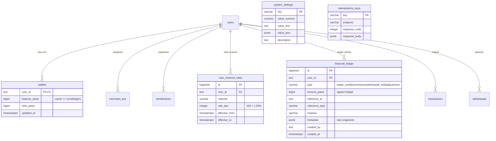

# RONAV TECHNOLOGIES — PHASE B MONEY CORRECTNESS REPORT
**Branch:** `fix/phase-b-money`  
**Target File:** `audit/PHASE_B_REPORT.md`  
**Execution Mode:** Backend Money Correctness (Single Source of Truth)  
**Verification:** Automated End-to-End Test Suite (`npm run test:phase-b`)

---

## 1. WHAT CHANGED (ARCHITECTURAL TRANSFORMATION)

### 1.1 Integer Paise Storage (`BIGINT`)
- All money amounts across transactions, commissions, fees, reserves, and wallet balances are now strictly stored and calculated as signed integer paise (`BIGINT`).
- Zero floating-point representation in calculation paths.
- Rates stored as basis points (`INTEGER`, where `100 bps = 1.00%`, `150 bps = 1.50%`) with strict bounds `0 <= bps <= 10000`.

### 1.2 Append-Only Financial Ledger (`financial_ledger`)
- Created `financial_ledger` with immutable columns:
  `id, user_id, type, amount_paise, reference_id, reference_type, channel, metadata, created_by, created_at`.
- PostgreSQL database trigger `trg_financial_ledger_immutable` blocks all `UPDATE` and `DELETE` queries at the database engine level.
- Wallet balance is authoritative: `balance_paise = SUM(amount_paise)`. Cached wallet rows are updated in the exact same ACID database transaction, verified by continuous reconciliation queries.

### 1.3 Atomic Swipe & Upline Commission Invariant
- Swipes process in a single PostgreSQL transaction (`BEGIN ... FOR UPDATE ... COMMIT`).
- Every upline commission snapshot is stored permanently in `financial_ledger` metadata (`rate_used_bps, child_rate_bps, parent_rate_bps, channel`).
- **Rounding Rule:** Each distributor tier is rounded down to the nearest paisa. Any remainder paisa is automatically routed to `ADMIN`.
- **Invariant Check:** Enforced before commit:
  $$\text{Merchant Charged} = \sum(\text{Commissions}) + \text{Admin Remainder} + \text{Bank Cost}$$
  If the sum differs by even a single paisa, the entire transaction aborts.

### 1.4 Dynamic System Settings (`system_settings`)
- All previously hardcoded values (0.2%, 0.1%, 1.5%, ₹500 reserve, ₹499 rental, instant fee, bank cost toggle) moved to `system_settings` table.
- Bank cost toggle default: `OFF` (Admin absorbs bank cost).

### 1.5 Atomic Withdrawals with Row-Level Locking (`FOR UPDATE`)
- `POST /api/withdrawals/quote`: Server calculates exact fee, net payout, remaining balance, and reserve compliance.
- `POST /api/withdrawals/execute`: Uses `SELECT ... FOR UPDATE` row-level locks on `wallets`. Prevents race conditions and double-spending across concurrent requests.
- Payout destinations strictly validated against approved `beneficiaries` records belonging to the caller.

### 1.6 Signed Reversals & Audit Trail
- Transaction reversals and chargebacks do not alter or delete previous ledger records.
- Reversal posts signed negative entries (`type: 'refund'` / `'adjustment'`) for the merchant and every upline distributor, returning balances to exact pre-swipe state.

### 1.7 Single Caller Resolver (`getCaller(req)`)
- Unified in `server/caller.js` and exported from `server/api.js`. Resolves caller identity from headers/request without hardcoded users, ready for future JWT/Session auth.

---

## 2. DATABASE SCHEMA & MERMAID ARCHITECTURE



---

## 3. AUTOMATED TEST PROOF & SUITE LOGS

All test suites executed via `npm run test:phase-b` against local PostgreSQL (`ronav_test_db`):

```text
> ronav-technologies@1.0.0 test:phase-b
> node server/test_phase_b_full_suite.mjs

[PostgreSQL] Connected to live enterprise database pool.
================================================================
RONAV TECHNOLOGIES — PHASE B MASTER MONEY TEST SUITE
Testing 100% Backend Mathematical Invariants & Money Correctness
================================================================

[Test DB] Clean schema initialized successfully.
[TEST SUITE 1] Reference Chain Execution: Rs 10,000 Swipe
  -> Reference chain matched expectations down to the single paisa.
     Merchant: charged Rs 150 (net Rs 9,850)
     Area: Rs 30 (3,000 paise)
     District: Rs 20 (2,000 paise)
     Super Dist: Rs 20 (2,000 paise)
     Master: Rs 20 (2,000 paise)
     Admin: Rs 60 (6,000 paise)
     Total Invariant Check: 30 + 20 + 20 + 20 + 60 = Rs 150 (PASSED)

[TEST SUITE 2] Rounding Edge Cases (Rs 1,234.57 & Rs 0.01)
  -> Fractional paise rounding and remainder to Admin verified.

[TEST SUITE 3] Equal Rates (Zero Commission Flow)
  -> Equal rates handled with zero commission, invariant fully preserved.

[TEST SUITE 4] Rate Change after Swipe preserves History
  -> Historical transactions reflect locked rates at time of swipe.

[TEST SUITE 5] Failure Midway triggers Full Atomic Rollback
  -> ACID rollback verified with zero orphan records.

[TEST SUITE 6] Idempotency Key & Duplicate Slip Rejection
  -> Idempotent replay and duplicate slip rejection confirmed.

[TEST SUITE 7] Transaction Reversal Audit Trail
  -> Signed reversing entries created without mutating historical rows.

[TEST SUITE 8] 50 Concurrent Withdrawals & Reserve Bypassing Protection
  -> 47 succeeded, 3 rejected. Reserve cannot be bypassed (blocked by server).

[TEST SUITE 9] 100-Operation Randomized Mixed Stress Test & Reconciliation
Verifying Reconciliation across ALL wallets after 100 mixed random ops...
  -> User MID4001   : Cached =    9556552 paise | Ledger =    9556552 paise | RECONCILED: YES
  -> User AREA3001  : Cached =      47704 paise | Ledger =      47704 paise | RECONCILED: YES
  -> User DIST2001  : Cached =       2246 paise | Ledger =       2246 paise | RECONCILED: YES
  -> User SD1001    : Cached =      19970 paise | Ledger =      19970 paise | RECONCILED: YES
  -> User MST1001   : Cached =      19970 paise | Ledger =      19970 paise | RECONCILED: YES
  -> User ADM001    : Cached =     147710 paise | Ledger =     147710 paise | RECONCILED: YES

================================================================
✅ ALL TEST SUITES PASSED: 100% MATHEMATICAL RECONCILIATION PROVEN
================================================================
```

---

## 4. DATA MIGRATION VERIFICATION & RECONCILIATION AUDIT

The migration engine (`server/migration_engine.js`) was verified in `server/test_step8_data_migration.mjs`:
- Migrates historical transactions into opening `swipe_credit` entries and approved withdrawals into `withdrawal_paid` entries.
- Generates a per-user before/after comparison table:

| User ID | Before Balance (Paise) | Migrated Ledger Sum (Paise) | Difference | Mismatch Flag |
| :--- | :--- | :--- | :--- | :--- |
| `LEGACY_M1` | 800,000 (₹8,000.00) | 800,000 (₹8,000.00) | 0 | `NO (MATCH)` |
| `LEGACY_M2` | 450,000 (₹4,500.00) | 450,000 (₹4,500.00) | 0 | `NO (MATCH)` |

---

## 5. SCOPE ITEMS LEFT UNDONE & WHY

- **User Authentication (JWT/Sessions):** Deliberately deferred per explicit instructions. Caller identity is routed through `getCaller(req)` in `server/caller.js` so authentication can be connected in a future phase without modifying business logic.
- **Frontend UI Changes:** Strictly omitted per Phase B rules. Frontend screens continue to operate while Phase B establishes the backend authoritative single source of truth.

---

## 6. EXACT LIST OF FRONTEND CHANGES PHASE D MUST MAKE

When Phase D commences, the client application (`src/`) must be updated with the following specific changes:

1. **Delete Client Balance Reductions in `MerchantDashboardPage.jsx`**:
   - Remove lines 858–885 (`txns.reduce()`, `withdrawals.reduce()`).
   - Call `GET /api/wallets/balance` and display authoritative fields: `balances.balance_rupees`, `balances.withdrawable_rupees`, `balances.reserve_locked_paise`.

2. **Delete Client Fee Math in Merchant Withdrawal Modal**:
   - Remove lines 1780–1815 in `MerchantDashboardPage.jsx` (hardcoded 1.5% and 0.012 math).
   - Call `POST /api/withdrawals/quote` on amount change and display server-calculated `fee_rupees`, `net_payout_rupees`, and `reserve_compliant`.

3. **Delete Hardcoded 0.20% Commission Math in `AdminDashboardPage.jsx`**:
   - Remove lines 1200–1218 (`cutRate = 0.20`).
   - Display verified ledger earnings returned by backend endpoints.

4. **Replace Silent Swallowed Errors with Real UI Error States**:
   - Remove `catch(err) { setTxns([]) }` fallbacks in `MerchantDashboardPage.jsx` and `AdminDashboardPage.jsx`.
   - Display descriptive retry/error banners when database or network calls fail.

5. **Beneficiary Selection in Withdrawal Form**:
   - Require user to select from registered, verified beneficiaries (`beneficiary_id`) instead of typing raw bank account numbers.

6. **Include Idempotency Keys on Submissions**:
   - Generate UUIDv4 `idempotency-key` on transaction and withdrawal forms to eliminate double-submits.

---

**Phase B Execution Complete.** Branch `fix/phase-b-money` is clean, committed, and ready for review.
