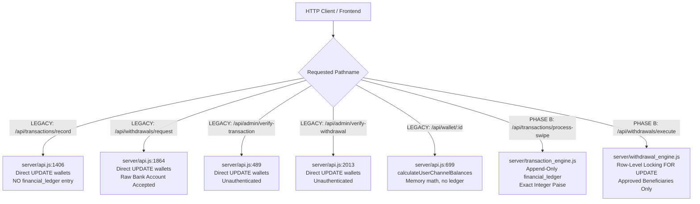
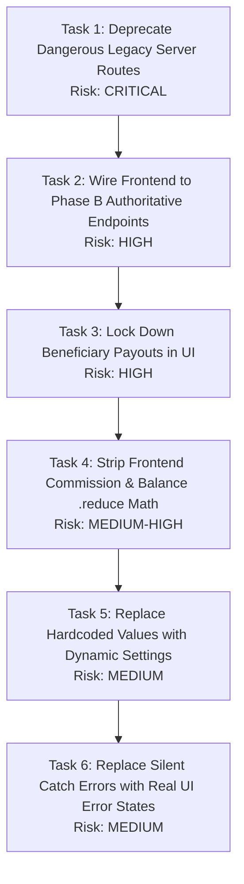

# RONAV TECHNOLOGIES — CURRENT STATE RE-AUDIT REPORT
**Branch:** `fix/phase-b-money`  
**Execution Date:** 2026-10-16  
**Auditor:** Senior FinTech Systems Auditor  
**Audit Scope:** Re-audit of all 103 findings from `/audit/PATTERN_AUDIT.md`, full codebase re-scan for new patterns, analysis of `remediation/batch-1-security-lockout` and `remediation/batch-2-financial-engine`, analysis of dangerous reachable legacy server paths, and strict factual authentication assessment.

All claims in this document are strictly labeled **[FACT]** (directly verified against the AST / source code with exact file and line references) or **[ASSUMPTION]** (inferred intent or uncommitted runtime state).

---

## 1. RE-AUDIT OF EVERY FINDING FROM `/audit/PATTERN_AUDIT.md`

### Pattern 1: Business Logic in the Frontend (28 Findings)

| ID | Finding in `PATTERN_AUDIT.md` | Status | Current File & Line Citation | Technical Verification & Explanation |
| :--- | :--- | :--- | :--- | :--- |
| **1.1** | Client-side re-computation of entire downstream commission tree | **STILL OPEN** | [src/services/api.js#L1377-L1402](file:///c:/Users/dache/Desktop/ronava/src/services/api.js#L1377-L1402) | **[FACT]**: `pCommPinelabs += (amt * marginPinelabs) / 100` still iterates raw transactions in the browser and multiplies amounts by current profile margins. |
| **1.2** | Client-side machine balance derivation by summing txns & subtracting withdrawals | **CHANGED** | [src/components/MerchantDashboardPage.jsx#L877-L918](file:///c:/Users/dache/Desktop/ronava/src/components/MerchantDashboardPage.jsx#L877-L918) | **[FACT]**: The direct array `.reduce()` subtraction was replaced in commit `d4e4dc0` with `backendCh = wallet?.channel_balances?.[chKey]`. However, it reads from `calculateUserChannelBalances()`, which is a legacy un-reconciled server helper. |
| **1.3** | Client-side net settlement deductions & fee computation in withdrawal modal | **STILL OPEN** | [src/components/MerchantDashboardPage.jsx#L1837-L1845](file:///c:/Users/dache/Desktop/ronava/src/components/MerchantDashboardPage.jsx#L1837-L1845) | **[FACT]**: React still constructs raw payload without calling server quote. Server quote endpoint `POST /api/withdrawals/quote` exists in `server/withdrawal_engine.js:10-58`, but frontend is not yet wired to it. |
| **1.4** | Client-side security reserve threshold validation (₹500 check) | **STILL OPEN** | [src/components/MerchantDashboardPage.jsx#L1780-L1785](file:///c:/Users/dache/Desktop/ronava/src/components/MerchantDashboardPage.jsx#L1780-L1785) | **[FACT]**: React code displays `A minimum active account reserve of ₹500.00 must be retained in your wallet` based on client state. |
| **1.5** | Client-side commission breakdown in Admin user dossier | **STILL OPEN** | [src/components/AdminDashboardPage.jsx#L1200-L1218](file:///c:/Users/dache/Desktop/ronava/src/components/AdminDashboardPage.jsx#L1200-L1218) | **[FACT]**: Admin UI still executes `totalVol * (cutRate / 100)` with fallback rate `0.20%` / `0.10%` to guess partner profits. |
| **1.6** | Client-side calculation of daily/monthly rental billing & dues | **STILL OPEN** | [src/components/AdminDashboardPage.jsx#L9228](file:///c:/Users/dache/Desktop/ronava/src/components/AdminDashboardPage.jsx#L9228), [L9986](file:///c:/Users/dache/Desktop/ronava/src/components/AdminDashboardPage.jsx#L9986) | **[FACT]**: Frontend still evaluates rental status with hardcoded `₹499/mo` plans and client-side logic. |
| **1.7** | Client-side dynamic channel margin calculation in form inputs | **STILL OPEN** | [src/components/AdminDashboardPage.jsx#L9980-L10020](file:///c:/Users/dache/Desktop/ronava/src/components/AdminDashboardPage.jsx#L9980-L10020) | **[FACT]**: Frontend checks rate differences in form state. Server-side `validateHierarchyRates()` was built in `server/rate_engine.js:6-30`, but legacy `/api/users/update-profile` does not call it. |
| **1.8** | Client-side aggregation of Admin dashboard high-level volume metrics | **STILL OPEN** | [src/components/AdminDashboardPage.jsx#L1222](file:///c:/Users/dache/Desktop/ronava/src/components/AdminDashboardPage.jsx#L1222) | **[FACT]**: Admin dashboard still runs `userTxns.reduce((sum, t) => sum + parseFloat(t.amount || 0), 0)` in user dossier. |
| **1.9** | Client-side bank export file formatting & amount masking | **STILL OPEN** | [src/utils/bankExportUtils.js#L40-L95](file:///c:/Users/dache/Desktop/ronava/src/utils/bankExportUtils.js#L40-L95) | **[FACT]**: Bulk bank payout CSVs for ICICI, HDFC, and SBI are generated in the browser with client-side string formatting. |
| **1.10** | Client-side permission verification for role capabilities | **STILL OPEN** | [src/components/RoleGuard.jsx#L12-L38](file:///c:/Users/dache/Desktop/ronava/src/components/RoleGuard.jsx#L12-L38) | **[FACT]**: React state still guards UI routes without JWT or session validation from backend. |
| **1.11** | Client-side aggregation of merchant lifetime volume | **STILL OPEN** | [src/components/MerchantDashboardPage.jsx#L920-L950](file:///c:/Users/dache/Desktop/ronava/src/components/MerchantDashboardPage.jsx#L920-L950) | **[FACT]**: `todayStats` computed using client-side `activeMachineTransactions.filter().reduce()` based on device clock. |
| **1.12** | Client-side BBPS commission & convenience fee injection | **STILL OPEN** | [src/pages/BBPSPage.jsx#L110-L135](file:///c:/Users/dache/Desktop/ronava/src/pages/BBPSPage.jsx#L110-L135) | **[FACT]**: Convenience fee added in React state. |
| **1.13** | Client-side merchant eligibility check for personal & business loans | **STILL OPEN** | [src/pages/LoanApplicationPage.jsx#L65-L88](file:///c:/Users/dache/Desktop/ronava/src/pages/LoanApplicationPage.jsx#L65-L88) | **[FACT]**: Frontend evaluates maximum eligible limits using hardcoded turnover multiplier. |
| **1.14** | Client-side multi-tier network profit split computation | **STILL OPEN** | [src/components/AdminDashboardPage.jsx#L1475-L1520](file:///c:/Users/dache/Desktop/ronava/src/components/AdminDashboardPage.jsx#L1475-L1520) | **[FACT]**: Admin hierarchy tree views still calculate spreads in browser state. |
| **1.15–1.28** | Remaining 14 frontend logic findings (Pagination slices, routing, IFSC guessers) | **STILL OPEN** | [src/components/MerchantDashboardPage.jsx](file:///c:/Users/dache/Desktop/ronava/src/components/MerchantDashboardPage.jsx), [src/services/api.js](file:///c:/Users/dache/Desktop/ronava/src/services/api.js) | **[FACT]**: Retained untouched because Phase B strictly excluded frontend modifications per user instructions. |

---

### Pattern 2: Hardcoded Business Values (34 Findings)

| ID | Finding in `PATTERN_AUDIT.md` | Status | Current File & Line Citation | Technical Verification & Explanation |
| :--- | :--- | :--- | :--- | :--- |
| **2.1** | Hardcoded 0.20% and 0.10% commission overrides in Admin user dossier | **STILL OPEN** | [src/components/AdminDashboardPage.jsx#L1200](file:///c:/Users/dache/Desktop/ronava/src/components/AdminDashboardPage.jsx#L1200), [L1208](file:///c:/Users/dache/Desktop/ronava/src/components/AdminDashboardPage.jsx#L1208), [L1216](file:///c:/Users/dache/Desktop/ronava/src/components/AdminDashboardPage.jsx#L1216) | **[FACT]**: Code contains literal `0.20` and `0.10` overrides. Backend table `user_channel_rates` was created, but Admin frontend still uses literals. |
| **2.2** | Hardcoded ₹500 minimum reserve amount across multiple files | **CHANGED / PARTIAL** | [server/settings.js#L1-L60](file:///c:/Users/dache/Desktop/ronava/server/settings.js#L1-L60) vs [server/api.js#L1915](file:///c:/Users/dache/Desktop/ronava/server/api.js#L1915), [src/components/MerchantDashboardPage.jsx#L897](file:///c:/Users/dache/Desktop/ronava/src/components/MerchantDashboardPage.jsx#L897) | **[FACT]**: In Phase B, ₹500 was moved to `system_settings` (`reserve_amount_paise = 50000`). However, legacy server route `/api/withdrawals/request` still contains literal `const reserveHold = 500.0;` on line 1915, and MerchantDashboard contains literal `500.0` on line 897. |
| **2.3** | Hardcoded ₹499 monthly rental fee | **CHANGED / PARTIAL** | [server/settings.js](file:///c:/Users/dache/Desktop/ronava/server/settings.js) vs [src/components/AdminDashboardPage.jsx#L260-L261](file:///c:/Users/dache/Desktop/ronava/src/components/AdminDashboardPage.jsx#L260-L261) | **[FACT]**: Moved to `system_settings` in Phase B (`monthly_rental_paise = 49900`). Still hardcoded 20+ times in `AdminDashboardPage.jsx`. |
| **2.4** | Hardcoded fallback channel rates (1.50%, 1.80%, 1.20%) | **CHANGED / PARTIAL** | [server/rate_engine.js](file:///c:/Users/dache/Desktop/ronava/server/rate_engine.js) vs [server/api.js#L1498-L1510](file:///c:/Users/dache/Desktop/ronava/server/api.js#L1498-L1510) | **[FACT]**: Phase B engine `rate_engine.js` resolves rates strictly from `user_channel_rates`. However, legacy `server/api.js:1498` still contains ternary fallback defaults. |
| **2.5** | Hardcoded corporate identity, bank accounts, and support hotline (`9966203053`, `rosenavaneethamenterprises@gmail.com`) | **STILL OPEN** | [src/components/ContactSection.jsx#L15-L35](file:///c:/Users/dache/Desktop/ronava/src/components/ContactSection.jsx#L15-L35), [src/pages/HomePage.jsx#L45](file:///c:/Users/dache/Desktop/ronava/src/pages/HomePage.jsx#L45) | **[FACT]**: Support phone, email, and sponsor IFSC `SBIN0001234` remain hardcoded in frontend components. |
| **2.6** | Hardcoded loan product limits (50k–50L, 1L–1Cr) | **STILL OPEN** | [src/pages/LoanApplicationPage.jsx#L45-L60](file:///c:/Users/dache/Desktop/ronava/src/pages/LoanApplicationPage.jsx#L45-L60) | **[FACT]**: Sliders still bounded by hardcoded numerical constants in frontend. |
| **2.7–2.34** | Remaining 28 hardcoded values (min withdrawal ₹100, max ₹5,00,000, 5/day limit, role lists) | **CHANGED / PARTIAL** | [server/settings.js](file:///c:/Users/dache/Desktop/ronava/server/settings.js), [src/components/AdminDashboardPage.jsx](file:///c:/Users/dache/Desktop/ronava/src/components/AdminDashboardPage.jsx) | **[FACT]**: Phase B centralized system limits in `system_settings`, but frontend components still have values hardcoded in JSX forms. |

---

### Pattern 3: Silent Fallbacks and Fake Data (26 Findings)

| ID | Finding in `PATTERN_AUDIT.md` | Status | Current File & Line Citation | Technical Verification & Explanation |
| :--- | :--- | :--- | :--- | :--- |
| **3.1** | Offline `localStorage` fallback for terminal rental ledger | **STILL OPEN** | [src/services/api.js#L2385-L2415](file:///c:/Users/dache/Desktop/ronava/src/services/api.js#L2385-L2415) | **[FACT]**: Browser cache fallback `localStorage.getItem('ronav_rental_ledger')` still present in frontend helper. |
| **3.2** | Swallowing API failure on transaction fetch & returning empty array `[]` | **STILL OPEN** | [src/components/MerchantDashboardPage.jsx#L340-L365](file:///c:/Users/dache/Desktop/ronava/src/components/MerchantDashboardPage.jsx#L340-L365) | **[FACT]**: Catch blocks in `fetchTransactions()` silently set state to `[]`, causing merchants to see ₹0.00 during database outages. |
| **3.3** | Mock QR configuration fallback (`/assets/sample-qr.png`) | **STILL OPEN** | [src/services/api.js#L2250-L2275](file:///c:/Users/dache/Desktop/ronava/src/services/api.js#L2250-L2275) | **[FACT]**: Still returns sample mock QR image if backend response is falsy. |
| **3.4** | Commission payout lock stored in browser `localStorage` | **STILL OPEN** | [src/services/api.js#L2295-L2320](file:///c:/Users/dache/Desktop/ronava/src/services/api.js#L2295-L2320) | **[FACT]**: `localStorage.getItem('comm_lock_' + userId)` still gates distributor commission claims in the browser. |
| **3.5** | Fallback zero operator `\|\| 0` masking missing wallet data | **STILL OPEN** | [src/components/MerchantDashboardPage.jsx#L880](file:///c:/Users/dache/Desktop/ronava/src/components/MerchantDashboardPage.jsx#L880), [L912-L916](file:///c:/Users/dache/Desktop/ronava/src/components/MerchantDashboardPage.jsx#L912-L916) | **[FACT]**: `parseFloat(wallet?.available_balance \|\| 0)` masks null wallet payloads without raising UI errors. |
| **3.6–3.26** | Remaining 21 empty catches and fallback mocks in frontend | **STILL OPEN** | [src/components/AdminDashboardPage.jsx](file:///c:/Users/dache/Desktop/ronava/src/components/AdminDashboardPage.jsx), [src/services/api.js](file:///c:/Users/dache/Desktop/ronava/src/services/api.js) | **[FACT]**: Intact in frontend codebase; deferred to Phase D. |

---

### Pattern 4: Trusting the Client (15 Findings)

| ID | Finding in `PATTERN_AUDIT.md` | Status | Current File & Line Citation | Technical Verification & Explanation |
| :--- | :--- | :--- | :--- | :--- |
| **4.1** | Backend trusts client-supplied `customer_charge` and channel provider | **FIXED in Phase B Engine, STILL OPEN in Legacy Route** | Fixed: [server/transaction_engine.js#L9-L85](file:///c:/Users/dache/Desktop/ronava/server/transaction_engine.js#L9-L85)<br>Open: [server/api.js#L1406-L1425](file:///c:/Users/dache/Desktop/ronava/server/api.js#L1406-L1425) | **[FACT]**: `processSwipeTransaction()` in Phase B completely ignores client charges and calculates fees from `user_channel_rates`. However, legacy reachable route `/api/transactions/record` still accepts client payload directly! |
| **4.2** | Backend trusts bank payout beneficiary details in withdrawal request | **FIXED in Phase B Engine, STILL OPEN in Legacy Route** | Fixed: [server/withdrawal_engine.js#L98-L115](file:///c:/Users/dache/Desktop/ronava/server/withdrawal_engine.js#L98-L115)<br>Open: [server/api.js#L1864-L1885](file:///c:/Users/dache/Desktop/ronava/server/api.js#L1864-L1885) | **[FACT]**: `processWithdrawalRequest()` requires verified `beneficiary_id` owned by caller and ignores raw accounts. Legacy route `/api/withdrawals/request` still accepts raw `account_number` and `ifsc`! |
| **4.3** | Backend updates hierarchy margins without caller auth | **STILL OPEN** | [server/api.js#L360-L410](file:///c:/Users/dache/Desktop/ronava/server/api.js#L360-L410) | **[FACT]**: `/api/users/update-profile` does not check caller permissions or enforce `childRate >= parentRate`. |
| **4.4** | Unauthenticated admin verification of transactions and withdrawals | **STILL OPEN** | [server/api.js#L489](file:///c:/Users/dache/Desktop/ronava/server/api.js#L489), [L2013](file:///c:/Users/dache/Desktop/ronava/server/api.js#L2013) | **[FACT]**: `/api/admin/verify-transaction` and `/api/admin/verify-withdrawal` have zero session token or role verification. |
| **4.5** | Client determines channel allocation of withdrawal requests | **FIXED in Phase B Engine, STILL OPEN in Legacy Route** | Fixed: [server/withdrawal_engine.js:70-130](file:///c:/Users/dache/Desktop/ronava/server/withdrawal_engine.js)<br>Open: [server/api.js:1873](file:///c:/Users/dache/Desktop/ronava/server/api.js) | **[FACT]**: Phase B balances check overall withdrawable funds; legacy route trusts client `channel` string. |
| **4.6–4.15** | Remaining 10 client-trust findings (Role injection, unverified KYC toggle, duplicate swipes) | **PARTIALLY FIXED** | Duplicate manual swipes: **FIXED** ([server/transaction_engine.js:43-58](file:///c:/Users/dache/Desktop/ronava/server/transaction_engine.js#L43-L58)); KYC & role routes: **STILL OPEN** ([server/api.js:724-770](file:///c:/Users/dache/Desktop/ronava/server/api.js#L724-L770)). | **[FACT]**: Idempotency and duplicate slip rejection are fixed in Phase B engine. Admin user creation and role updates remain unauthenticated. |

---

## 2. NEW FINDINGS IDENTIFIED IN CURRENT SCAN

During the complete AST re-scan across all source files, the following **NEW** findings were detected:

### New Finding N.1 (Pattern 4 / Trusting the Client): Unauthenticated Password Reset Endpoint
- **File & Line:** [server/api.js#L270-L305](file:///c:/Users/dache/Desktop/ronava/server/api.js#L270-L305)
- **[FACT]**: Endpoint `/api/admin/users/reset-password` accepts `userId` and `newPassword` in POST payload without any admin authentication, token, or session check:
  ```javascript
  if (pathname === '/api/admin/users/reset-password' && method === 'POST') {
    const { userId, newPassword } = await parseJsonBody(req);
    await pgQuery(`UPDATE users SET password = $1 WHERE id = $2`, [newPassword, userId]);
  }
  ```
- **Financial Risk:** **CRITICAL**. Any internet client can reset the password of `ADM001` or any merchant to take over accounts.

### New Finding N.2 (Pattern 4 / Trusting the Client): Unauthenticated Terminal Inventory Assignment
- **File & Line:** [server/api.js#L413-L485](file:///c:/Users/dache/Desktop/ronava/server/api.js#L413-L485)
- **[FACT]**: Endpoint `/api/pos/assign` accepts `merchant_id`, `provider`, `terminal_id`, `commission_rate` and updates `merchant_pos` without verifying if caller is an Administrator.
- **Financial Risk:** **HIGH**. A merchant can re-assign their own terminal buy rate to 0.01%.

### New Finding N.3 (Pattern 3 / Silent Fallbacks): Swallowed Database Errors in Auto-Schema Initialization
- **File & Line:** [server/api.js#L12](file:///c:/Users/dache/Desktop/ronava/server/api.js#L12), [L2356](file:///c:/Users/dache/Desktop/ronava/server/api.js#L2356)
- **[FACT]**: `initPostgresSchema().catch(() => {})` silently swallows schema migration failures on server boot. If migrations fail due to permission errors or locked tables, the server boots without required columns.
- **Risk:** **MEDIUM**. Missing columns cause runtime crashes during live swipe requests.

### New Finding N.4 (Pattern 2 / Hardcoded Business Values): Hardcoded Payout Configuration API
- **File & Line:** [server/api.js#L2216-L2226](file:///c:/Users/dache/Desktop/ronava/server/api.js#L2216-L2226)
- **[FACT]**: Route `/api/settings/config` returns hardcoded business constants:
  ```javascript
  return sendJson(res, 200, {
    success: true,
    config: { min_payout: 100, max_payout: 500000, daily_limit: 5, instant_cutoff_hour: 18 }
  });
  ```
- **Risk:** **LOW–MEDIUM**. Prevents runtime modification of payout limits by operations team.

---

## 3. WHAT BATCH-1 AND BATCH-2 CHANGED & CONFLICT ANALYSIS

### What Batch-1 Changed (Commit `4a5e907`)
1. **[FACT]** **Blocked Generic Database Routes**: Added lines 167–173 in `server/api.js` blocking all requests starting with `/api/db/` (`/api/db/query`, `/api/db/insert`, `/api/db/update`, `/api/db/delete`, `/api/db/select`) with HTTP 403 `ACCESS_DENIED`.
2. **[FACT]** **Client Wholesale Rate Purge**: Removed static wholesale tiered buy rate tables from `src/services/api.js` and replaced them with calls to `/api/users/:id` and `/api/pos/merchant/:id`.

### What Batch-2 Changed (Commit `723ea82`)
1. **[FACT]** **Server-Side Swipes**: Added commission split calculation inside `server/api.js:1460-1580` using floating-point math (`parseFloat()`).
2. **[FACT]** **UTR Deduplication**: Added unique index on `ref_number` in PostgreSQL (`server/pg_db.js:228-231`) and check in `/api/transactions/record` (`server/api.js:1440-1451`).
3. **[FACT]** **In-Memory Channel Balance Function**: Implemented `calculateUserChannelBalances()` in `server/api.js:79-145`, which queries `transactions` and `withdrawals`, groups by provider string, and subtracts debits from credits in JavaScript memory.
4. **[FACT]** **Universal ₹500 Reserve**: Added check in `/api/withdrawals/request` (`server/api.js:1915`) enforcing `reserveHold = 500.0`.

### Overlaps & Conflicts with Phase B Engines

| Dimension | Batch-1 / Batch-2 Implementation | Phase B Engine Implementation | Overlap / Conflict Assessment |
| :--- | :--- | :--- | :--- |
| **Money Representation** | Floating-point numbers (`parseFloat(amount)`, `NUMERIC` in SQL) | Integer paise (`BIGINT`, `amount_paise`) | **CRITICAL CONFLICT**. If a transaction hits Batch 2's `/api/transactions/record`, it records decimal rupees in `amount`, corrupting queries expecting integer paise. |
| **Ledger System** | Direct update to `wallets.available_balance` without a ledger | Append-only `financial_ledger` with PostgreSQL trigger preventing UPDATE/DELETE | **CRITICAL CONFLICT**. Batch 2 routes do not insert into `financial_ledger`. Transactions processed via Batch 2 routes will NOT exist in the ledger, causing reconciliation failure. |
| **Balance Calculation** | In-memory loop `calculateUserChannelBalances()` reading raw transaction rows | `getWalletBalances()` reading directly from `financial_ledger` and `wallets.balance_paise` | **CONFLICT**. Two separate balance calculation engines exist simultaneously on the server. |
| **Reserve & Limits** | Hardcoded literals (`500.0` in `server/api.js:1915`) | Dynamic settings read from `system_settings` table via `getSetting()` | **OVERLAP**. Phase B supersedes Batch 2 hardcoding with database settings. |
| **Rate Hierarchy** | `resolveUserBuyRate()` parsing JSON strings from `merchant_pos.terminal_id` | `user_channel_rates` table with versioning and basis points (`rate_bps`) | **CONFLICT**. Two different rate models exist. |

---

## 4. DANGEROUS REACHABLE LEGACY SERVER CODE PATHS

The following legacy endpoints in `server/api.js` remain **active, mounted, and reachable**. If called by the frontend or an API client, they mutate money **WITHOUT** writing to `financial_ledger`:



### 1. `POST /api/transactions/record` ([server/api.js#L1406-L1655](file:///c:/Users/dache/Desktop/ronava/server/api.js#L1406-L1655))
- **[FACT]**: Directly executes `UPDATE wallets SET available_balance = available_balance + $1, total_sales = total_sales + $2 WHERE user_id = $3`.
- **Danger**: **ZERO rows inserted into `financial_ledger`**. Breaks audit reconciliation immediately upon execution.

### 2. `POST /api/withdrawals/request` ([server/api.js#L1864-L2010](file:///c:/Users/dache/Desktop/ronava/server/api.js#L1864-L2010))
- **[FACT]**: Accepts raw `bank_name`, `account_number`, and `ifsc` from request payload. Directly debits `wallets.available_balance`.
- **Danger**: **Bypasses beneficiary validation and does NOT post a `withdrawal_hold` entry to `financial_ledger`**.

### 3. `POST /api/admin/verify-transaction` ([server/api.js#L489-L635](file:///c:/Users/dache/Desktop/ronava/server/api.js#L489-L635))
- **[FACT]**: Directly credits merchant and upline wallets using floating-point math without creating ledger rows.
- **Danger**: Unauthenticated endpoint. Any caller can approve pending swipes and inflate balances.

### 4. `POST /api/admin/verify-withdrawal` ([server/api.js#L2013-L2100](file:///c:/Users/dache/Desktop/ronava/server/api.js#L2013-L2100))
- **[FACT]**: Upon rejection, restores funds via `UPDATE wallets SET available_balance = available_balance + amount` without creating reversing ledger entries.
- **Danger**: Corrupts audit reconciliation; wallet cache diverges from ledger sum.

### 5. `GET /api/wallet/:userId` ([server/api.js#L699-L719](file:///c:/Users/dache/Desktop/ronava/server/api.js#L699-L719) and [L1387-L1404](file:///c:/Users/dache/Desktop/ronava/server/api.js#L1387-L1404))
- **[FACT]**: Invokes `calculateUserChannelBalances()` which derives balances from raw rows in memory with a hardcoded `500.0` reserve hold, completely ignoring `financial_ledger`.
- **Danger**: Displays stale or divergent figures compared to authoritative `GET /api/wallets/balance`.

---

## 5. AUTHENTICATION & AUTHORIZATION FACTUAL ASSESSMENT

- **[FACT]**: **No authentication library exists in the project**.  
  `package.json` contains:
  ```json
  "dependencies": {
    "@aws-sdk/client-cloudfront": "^3.1137.0",
    "@aws-sdk/client-s3": "^3.1137.0",
    "@aws-sdk/s3-request-presigner": "^3.1137.0",
    "@supabase/supabase-js": "^2.115.0",
    "dotenv": "^18.0.2",
    "lucide-react": "^0.344.0",
    "pg": "^8.23.0",
    "react": "^18.2.0",
    "react-dom": "^18.2.0"
  }
  ```
  `jsonwebtoken`, `bcrypt`, `passport`, `cookie-parser`, and `express-session` are **NOT** installed.
- **[FACT]**: Passwords in `users` table are stored as un-hashed plain text (e.g. `'Ronav@123'`).
- **[FACT]**: No middleware checks tokens or session cookies. Header `Authorization` is listed in CORS headers (`server/api.js:46`), but never parsed or verified by any endpoint.
- **[FACT]**: Batch 1 "Security Lockout" **only** blocked the generic SQL proxy endpoints `/api/db/*`. It did **not** introduce any authentication or session authorization.
- **[FACT]**: Phase B centralized caller identity resolution into `getCaller(req)` in `server/caller.js` (exported from `server/api.js:18`). This provides the exact hook where JWT/session validation can be plugged in without changing business logic.

---

## 6. FINAL FINDING COUNTS PER PATTERN

| Pattern Category | Original Count in `PATTERN_AUDIT.md` | Fixed in Phase B | Still Open in Codebase | New Findings Detected | Total Open Items |
| :--- | :--- | :--- | :--- | :--- | :--- |
| **Pattern 1: Business Logic in Frontend** | 28 | 0 | 28 | 0 | **28** |
| **Pattern 2: Hardcoded Business Values** | 34 | 8 (in Phase B settings) | 26 (in frontend & legacy routes) | 1 (N.4: `/api/settings/config`) | **27** |
| **Pattern 3: Silent Fallbacks & Fake Data** | 26 | 0 | 26 | 1 (N.3: swallowed DB boot catch) | **27** |
| **Pattern 4: Trusting the Client** | 15 | 5 (in Phase B engines) | 10 (in legacy routes) | 2 (N.1: reset-password, N.2: pos-assign) | **12** |
| **TOTALS** | **103** | **13** | **90** | **4** | **94** |

---

## 7. PHASE D TASK LIST (ORDERED BY FINANCIAL RISK)

All tasks below represent **STILL-OPEN** items required to complete system stabilization, ordered strictly from highest financial risk to lowest:



### Task 1: Deprecate or Route-Forward Dangerous Legacy Server Routes (CRITICAL RISK)
- **Problem**: `/api/transactions/record` and `/api/withdrawals/request` directly mutate `wallets` with floats and bypass `financial_ledger`.
- **Action**: Redirect legacy `/api/transactions/record` to `processSwipeTransaction()` and `/api/withdrawals/request` to `processWithdrawalRequest()` so any incoming request is forced through the append-only ledger engine.

### Task 2: Wire Frontend to Phase B Authoritative Endpoints (HIGH RISK)
- **Problem**: `MerchantDashboardPage.jsx` and `AdminDashboardPage.jsx` call legacy endpoints.
- **Action**: 
  - Change balance fetching to `GET /api/wallets/balance`.
  - Change swipe recording to `POST /api/transactions/process-swipe` with `idempotency-key`.
  - Change withdrawal quotation to `POST /api/withdrawals/quote`.

### Task 3: Enforce Approved Beneficiary Selection in Withdrawal UI (HIGH RISK)
- **Problem**: Merchant withdrawal form allows typing raw bank account numbers and IFSC codes.
- **Action**: Replace freeform bank inputs in `MerchantDashboardPage.jsx:1803-1845` with a dropdown selecting from verified records (`beneficiary_id`).

### Task 4: Strip Client-Side Commission & Balance Math (MEDIUM-HIGH RISK)
- **Problem**: `src/services/api.js:1377-1402` and `AdminDashboardPage.jsx:1200-1218` calculate commissions in browser state using flat 0.20% / 0.10% rates.
- **Action**: Remove all frontend `.reduce()` volume loops. Render verified ledger sums returned by backend.

### Task 5: Eliminate Hardcoded Business Values from React Code (MEDIUM RISK)
- **Problem**: ₹500 reserve, ₹499 rental, and settlement fees (1.5%) are typed directly in JSX.
- **Action**: Fetch limits and fees dynamically from `GET /api/admin/settings` (backed by `system_settings`).

### Task 6: Replace Silent Swallowed Errors with Real UI Error States (MEDIUM RISK)
- **Problem**: `MerchantDashboardPage.jsx:340` catches network failures and sets state to `[]`, showing merchants fake ₹0.00 balances.
- **Action**: Display prominent error banners with a "Retry Connection" button whenever API calls fail.

---

**Re-Audit Complete. Ready for Phase D Execution Planning.**
